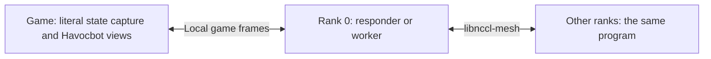

# Policy transport ownership

The game's engine and the process that answers it (the solver worker or the policy
responder, xonotic/README.md) share one local datagram socket on the game's host. Between
nodes everything rides libnccl-mesh: each model call is announced to every rank in one
broadcast and the partitioned products' collectives are torch.distributed's `mesh`
backend. There is no second mesh client.

## Local control envelope

Every datagram is the `<iII` envelope (node, frame bytes, count) and `count` frames of
`frame bytes` each, in either direction. A frame is the 48-byte wire header of
`rdma/xonwire.def` and its float32 values; a message is its kind's rows cut into frames
of one width. An empty message keeps its explicit zero-row header.

## The engine's end

`mesh_ipc.c` opens its socket at the game's first `mesh_open`, when the server was
started with `MESH_EXPERT_SOCKET` (the worker's path) and `MESH_EXPERT_FRAMEBYTES` (its
frame size); without both, `mesh_open` returns -1 and the game publishes nothing. The
engine binds `/tmp/mesh-engine-<pid>.sock` and sends to the worker's path; it never
waits on the worker.

- Publications are serialized once into packets and sent at once, in order.
- The socket's descriptor is in the host's frame select, so a response is read as soon as
  it arrives; the host frame also pumps whatever the socket refused.
- A datagram the socket refuses for its size (EMSGSIZE) is cut into fewer frames, then
  into narrower frames; receivers derive a fragment's capacity from the frame they got.
- A full worker socket leaves the packet queued. The game makes no new snapshot until the
  previous one has left the engine (observation slot 28 counts those strategy ticks),
  and its events wait for the next snapshot.
- No worker bound at the path (ENOENT, ECONNREFUSED) empties the queue: there is no
  reader for it. The next snapshot goes to whichever worker binds the path.
- A response is assembled per handle and swapped whole into the one buffer the engine
  reads; the views apply it at their next read.
- A round's outcome is one OUTCOME row sent when the round ends.

## The worker's end

`xonotic/solver/xonwire.py` `Engine` binds the path and the caller waits on its
descriptor (select, with a signal's wakeup descriptor beside it). Each wake takes every
queued datagram. The engine's address is the source of its datagrams; a response is
sent to it at once, and a send the socket refuses is reported, the next response being
the next send. `RuntimeFrames` keeps one slot: the latest complete OBSERVATION, CART,
TEAM and STATE snapshot of a session and tick, which the caller takes when it is free;
EVENT rows and OUTCOME records accumulate until taken.
