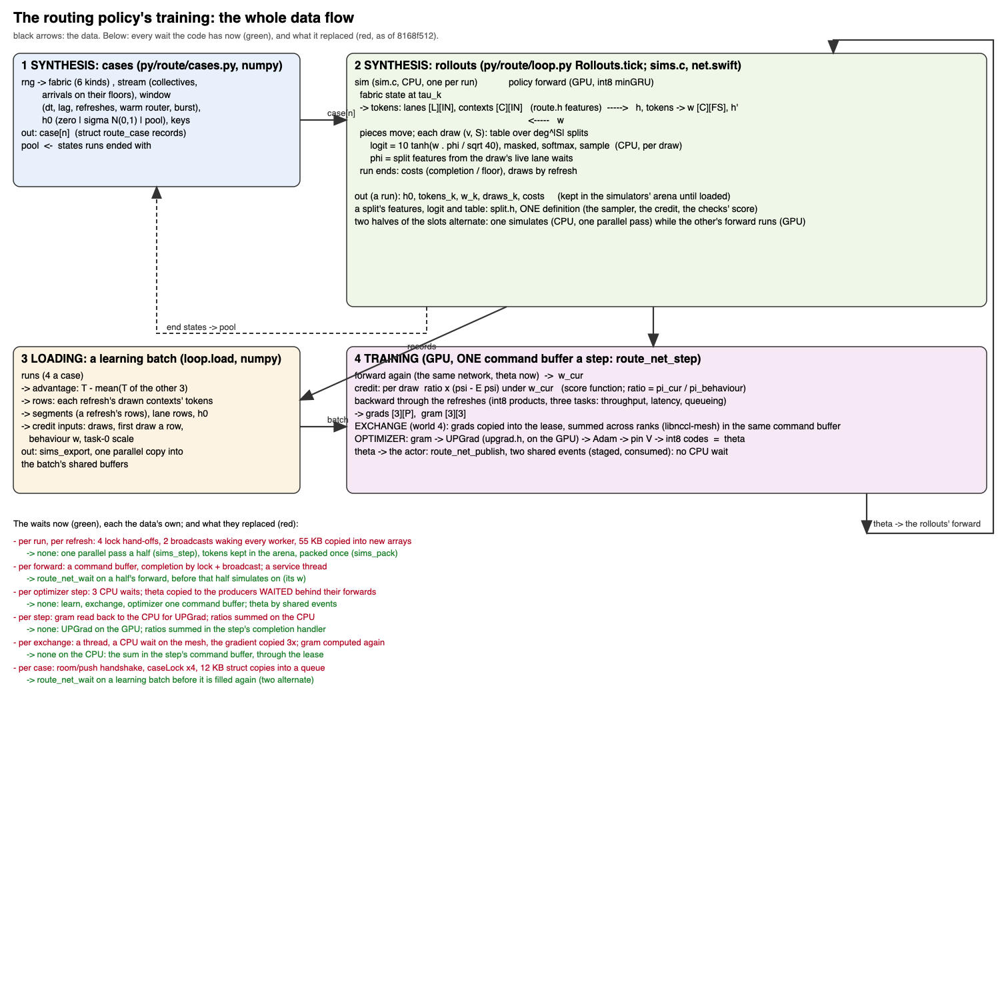

# The trainer's data flow

 (design/dataflow.py draws it)

## The loop (py/route/loop.py, the whole schedule)

```
cases  = Distribution.draw(groups)                  # synthesis: fabric, stream, window, h0 (zero | sigma N | pool), keys
begin(every group, cases)                           # sims.c: 4 simulators a case
while steps:
  for half in (0, 1):                               # one half simulates while the other's forward runs
    wait(forward[half])                             # WAIT: the half's w (the data's own dependency)
    sims_step(half's runs, w)                       # one parallel pass: answer, run to the next refresh or the end
    sims_pack(the runs at a refresh)                # one parallel copy into the forward's shared buffers
    forward[half] = commit(net.forward)             # GPU, not waited here
  for the groups whose 4 runs ended:
    wait(batch[j])                                  # WAIT: the batch's last step done with its buffers (two alternate)
    load: sims_export -> batch[j]; advantages        # one parallel copy; numpy
    commit(step: learn, exchange, gram, UPGrad, Adam, pin, codes)   # ONE command buffer, not waited
    publish(theta -> actor)                         # GPU queue order + two shared events, not waited
    pool += end states; begin(groups, draw())
```

Two waits, both on data the next line reads. Everything else is committed in the GPU's queue order.

## What was extracted, what was deleted (8168f512 -> now)

Headers, each one definition included by every user (as int8mm.h for the products):
- split.h: a draw's record (struct route_draw), a split's features, logit, slope and the table's online log-sum-exp.
  It was written three times: sim.c's build_table, route.h's split features, and net.metal's credit, which had a
  ±20 clamp the C side lacked. It is now included by sim.c's sampler, net.metal's credit and route_draw_score.
- upgrad.h: UPGrad's task weights, run on the GPU from the Gram matrix it makes. It was learn.swift's CPU function,
  which forced a read-back and a CPU wait every optimizer step.

Deleted, with their closures:
- runs.swift: the Runner, its worker threads, its service loop, two packing paths, per-refresh Kept copies.
- trainer.swift: the Trainer's threads, locks, case queue, the Exchange thread (and its CPU Gram matrix), gather.
- sim.c: the draw groups and their hash table; build_table; the 64-attempt rejection sampler with its enumeration
  fallback (now one inverse-CDF pass over the masked table); route_sim_credit, the CPU credit (route_draw_score over
  the same records replaces it for the checks); route.h's route_pre, route_split_pre and route_split_features (that
  last one unused).
- net.swift: learn and apply each waited on the CPU; now encodeLearn and encodeApply, one command buffer.
  refresh(from:) waited behind the forwards; route_net_publish replaces it.

Native code left is array kernels: sims.c (begin, step, pack, sizes, export: each a parallel pass), netapi.swift
(batch buffers; forward, step, publish committed; wait), exchange.c, forward.c, sim.c, the Metal kernels.

## Checks (python -m route ...)

- simcheck: the switch.c fixed router's table on the measured cluster.
- deploy: forward.c against the GPU forward on the first refresh.
- check --graph: the GPU's credit against split.h's on the CPU; scores against central differences; the fused codes;
  the int8 network against the fp32 reference.
